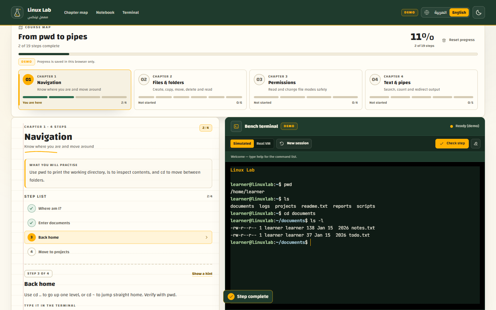
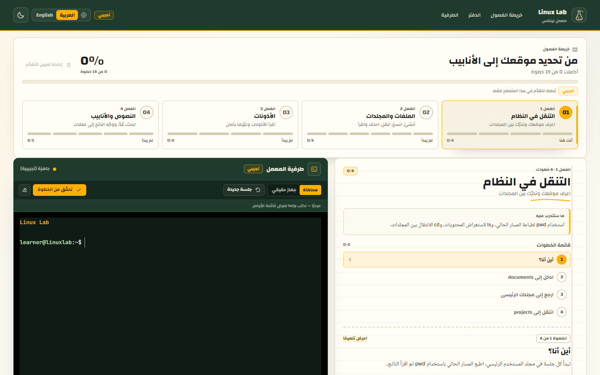
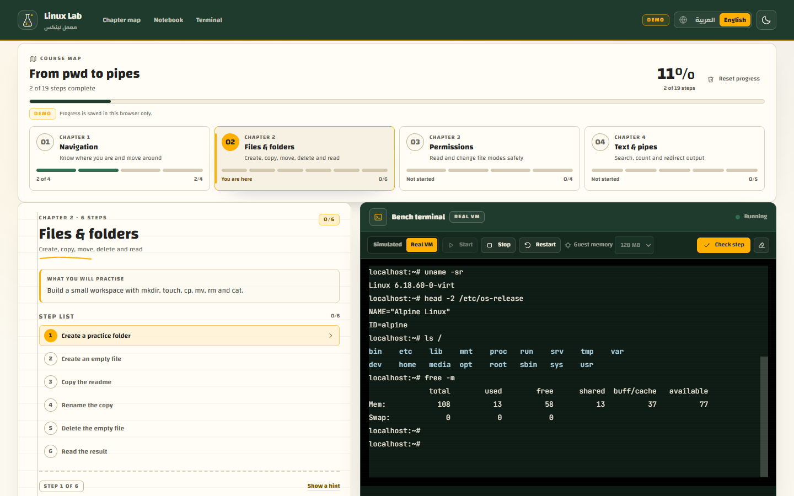
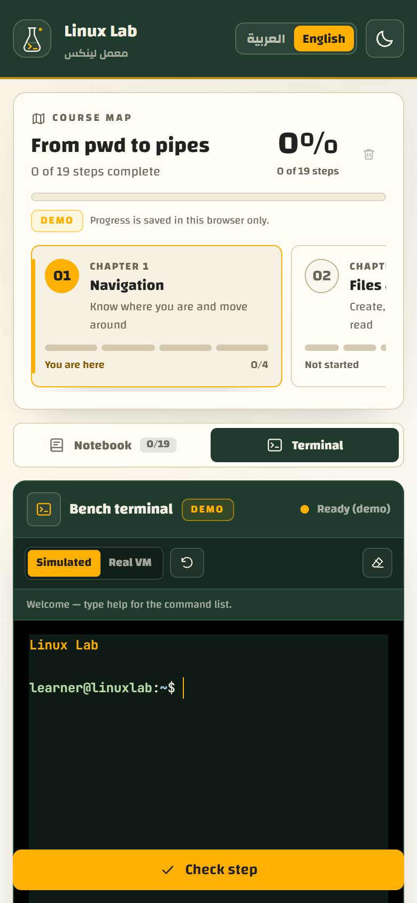
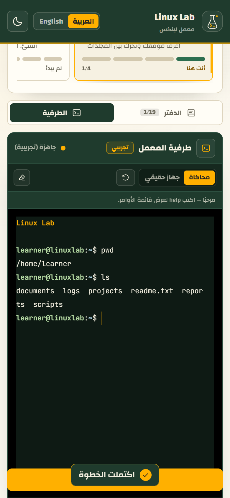

# Linux Lab

Learn the Linux command line in the browser, step by step, with instant checking.



Linux Lab is a lesson notebook beside a terminal. Each step asks for a command, and the lab checks the result as soon as you run it. It works fully offline in the browser, with no accounts and no server.

Two terminal modes are available: a built-in simulated shell that needs no downloads, and an optional real Linux machine (Alpine Linux) that boots inside the browser through the v86 emulator.

The interface is Arabic-first (right-to-left) with a complete English version.

## Highlights

- **Four chapters, 19 steps:** navigation (`pwd`, `ls`, `cd`), files and folders (`mkdir`, `touch`, `cp`, `mv`, `rm`, `cat`), permissions (`chmod`, `ls -l`) and text and pipes (`grep`, `wc`, `|`, `>`).
- **Automatic checking** after every command, with hints and a chapter map that shows progress.
- **Simulated terminal** with a virtual filesystem, ready instantly.
- **Real Linux VM:** start, stop and restart a real Alpine Linux guest in the browser, with a serial console and adjustable guest memory.
- **Local progress** saved in the browser, with a reversible reset.
- **Arabic and English** lessons, light and chalkboard themes, responsive from phone to desktop.

## Screenshots

**Chapter map** · Arabic



**Real Alpine Linux running in the browser** · English



**On mobile** (English and Arabic)

<p>
  
  
</p>

## Tech stack

| Layer | Technology |
| --- | --- |
| App | TypeScript (strict), React 19, Vite 8 |
| Styling | Tailwind CSS 4 |
| Terminal | xterm.js 6, v86 emulator (BSD-2-Clause) |
| Fonts | Changa, Noto Naskh Arabic and JetBrains Mono, self-hosted |
| Tests | Vitest |

No CDNs, trackers or analytics. All fonts and assets are self-hosted.

## Running locally

Requirements: Node.js 24 and npm.

```bash
npm ci
npm run dev
```

Then open http://localhost:5176.

The real-VM mode needs a BIOS and an Alpine Linux image, which are not stored in this repository because of their size and licences. [docs/IMAGES.md](docs/IMAGES.md) lists the exact files and where to put them. The simulated terminal works without them.

Full setup notes are in [INSTALL.md](INSTALL.md).

## Demo access

No sign-in. Progress is stored only in your browser. `npm run demo:reset` publishes a new demo marker so visitors start fresh.

All names, phone numbers, emails and records in the demo are fictional sample data.

## Tests

```bash
npm test
```

85 automated tests, all passing at the time of publishing. Details in [TESTING.md](TESTING.md).

## Documentation

- [INSTALL.md](INSTALL.md)
- [TESTING.md](TESTING.md)
- [SECURITY.md](SECURITY.md)
- [ROADMAP.md](ROADMAP.md)
- [docs/ARCHITECTURE.md](docs/ARCHITECTURE.md)
- [docs/DECISIONS.md](docs/DECISIONS.md)
- [THIRD-PARTY-NOTICES.md](THIRD-PARTY-NOTICES.md)

## License

Copyright © 2026 Fedaa Mohamed. All rights reserved.

This repository is public so the code can be reviewed. It is **not open source**: no permission is granted to use, copy, modify, distribute or sell any part of it without prior written permission. See [LICENSE](LICENSE). Third-party libraries and fonts keep their own licences, listed in [THIRD-PARTY-NOTICES.md](THIRD-PARTY-NOTICES.md).

---

Designed & built by [Fedaa Mohamed](https://fedaamohamed.com).
